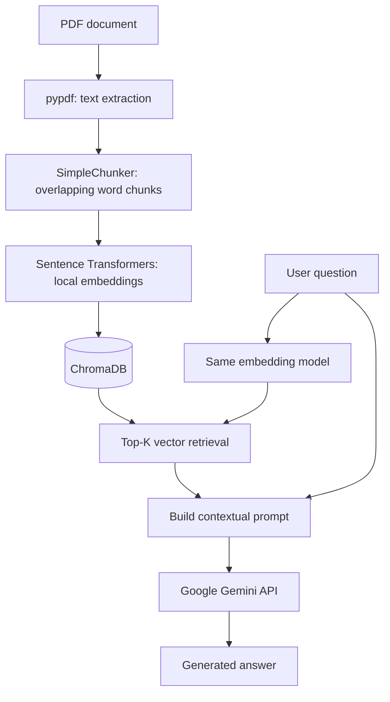

# DocMind RAG 

**A document question-answering prototype powered by Retrieval-Augmented Generation (RAG).**

DocMind RAG explores how to retrieve relevant passages from PDF documents using **local sentence embeddings** and **ChromaDB**, then provide those passages to **Google Gemini** to generate a contextual answer.

## Overview

A conventional language model may not know the contents of a private document. Retrieval-Augmented Generation adds a document-search step before generation:

1. Extract text from a PDF.
2. Split it into overlapping text chunks.
3. Encode chunks as numerical embeddings.
4. Store the chunks and vectors in ChromaDB.
5. Embed a user question and retrieve nearby chunks.
6. Send the retrieved context and question to Gemini.
7. Display the generated response.



## Technology stack

| Component | Current implementation | Purpose |
|---|---|---|
| Notebook environment | Google Colab | Interactive execution |
| PDF parsing | `pypdf` | Extract text from PDF pages |
| Chunking | Custom `SimpleChunker` | Split on word boundaries with overlap |
| Embeddings | `sentence-transformers` / `all-MiniLM-L6-v2` | Create local 384-dimensional text vectors |
| Vector database | `chromadb` | Store chunks and search for similar vectors |
| LLM | Google Gemini (`gemini-2.5-flash-lite` in source) | Generate answers from retrieved context |
| Authentication | Colab Secrets | Store `GEMINI_API_KEY` outside notebook source |

**API costs:** The local embeddings and local ChromaDB operations do not incur model API charges. Gemini API availability and free-tier quotas depend on the account, model, and current provider terms. A Google API key may be necessary for the generation step.

## Repository layout

The uploaded project was exported from Colab as a `.py` file. Publishing the original `.ipynb` is preferable because GitHub can display notebook code and Markdown sections together. The example layout is a recommendation, **not** a claim that these files are already present.

## Getting started with Google Colab

1. Open the notebook in [Google Colab](https://colab.research.google.com/).
2. Install the packages explicitly:

   ```python
   %pip install -q pypdf chromadb sentence-transformers google-genai
   ```

3. Upload a **non-sensitive, text-based PDF** into the Colab runtime. Update the `chemin_pdf` variable with the actual filename (for example `cours.pdf`). Scanned PDFs without extractable text are not handled by the current parser.
4. In the left sidebar, open **Secrets** (key icon). Add a secret named `GEMINI_API_KEY`, paste your Gemini API key, and allow notebook access.
5. Correct the API client initialization to use the secret value:

   ```python
   from google.colab import userdata
   from google import genai

   api_key = userdata.get("GEMINI_API_KEY")
   client = genai.Client(api_key=api_key)
   ```

6. **Reorder the notebook** so that `SimpleChunker`, `LocalEmbeddings`, `embedder`, and the ChromaDB `collection` are defined *before* the PDF-ingestion block that uses them.
7. Run the cells in order: dependency installation → imports → class definitions → embedding model → ChromaDB → PDF loading → chunking → indexing → retrieval → optional Gemini generation.
8. Try a question that has an answer explicitly present in the PDF; inspect the retrieved text before judging the model's answer.

### Run retrieval without Gemini

The PDF extraction, chunking, embeddings, ChromaDB indexing, and similarity search use local Python packages. They can be tested **without an API key**. Gemini is only required for the final text-generation call in the present architecture.

## How the RAG components work

### 1. PDF loader

`extraire_texte_pdf()` uses `pypdf.PdfReader` to extract text and concatenate it. Currently, the extraction loses the association between text and individual pages; page-level metadata is a planned improvement.

### 2. Chunker

`SimpleChunker` normalizes whitespace, splits the text by words, and creates overlapping passages. The code uses **word counts**, not model tokens. Example configuration for PDF indexing: `chunk_size=150`, `chunk_overlap=20`. Those are initial choices, not empirically optimized values.

### 3. Embedding model

`all-MiniLM-L6-v2` converts a chunk or question into a 384-dimensional vector. The same model must encode documents and questions. Because the default model is primarily English-oriented, testing a multilingual model is a logical next step for French-language documents.

### 4. ChromaDB index

The notebook creates a persistent ChromaDB collection (`mon_rag_local`) and stores text chunks together with embeddings and IDs. The current indexing code does not yet store document names or page numbers as metadata.

### 5. Retriever

The notebook calls `collection.query()` with a question embedding to get the nearest chunks. Chroma returns distances; these must not be presented as calibrated probabilities. The number of results (`top_k`) should be configurable and bounded by the collection size.

### 6. Gemini generation

A system instruction asks Gemini to answer using the retrieved context, and the user prompt contains the selected chunks and question. This is **grounding guidance**, not a guarantee that every generated statement is correct. The current code does not validate citations or evaluate answer faithfulness.

## Known issues before running

The **current exported version** is not guaranteed to execute from top to bottom without corrections:

- The PDF-ingestion block appears before `SimpleChunker`, `embedder`, and `collection` are initialized.
- The first installation command does not explicitly include `pypdf` and `chromadb`.
- `chemin_pdf = ".pdf"` is a placeholder rather than an uploaded filename.
- `genai.Client(api_key= ????)` is invalid Python and must be replaced with `genai.Client(api_key=api_key)` after retrieving the Colab secret.
- A demo text is indexed alongside PDF content in the same collection, which can contaminate search results.
- Re-running `collection.add()` with the same IDs can lead to indexing conflicts; use a controlled reindexing or `upsert()` strategy with stable IDs.
- The PDF content is concatenated without preserving source-page references.
- There is no retrieval benchmark or end-to-end automated test suite yet.

These are development tasks, not documented working features.

## Roadmap

- [ ] Make the notebook reproducible using **Runtime → Run all**.
- [ ] Separate the demo collection from the document collection.
- [ ] Keep filename, page number, and chunk index as metadata.
- [ ] Use stable chunk IDs and safe reindexing.
- [ ] Validate `chunk_size > chunk_overlap >= 0`.
- [ ] Compare a multilingual embedding model for French/English.
- [ ] Add Top-K configurability and inspect retrieved distances.
- [ ] Display source passages and page references with answers.
- [ ] Evaluate retrieval using labeled questions (Recall@K, Precision@K, MRR).
- [ ] Add tests for extraction, chunking, indexing, and retrieval.
- [ ] Support several documents and document deletion.
- [ ] Optionally develop a FastAPI backend and Streamlit interface.

## Privacy and security

- Do **not** commit API keys, `.env` files, uploaded PDFs, or personal/confidential source material.
- Keep `GEMINI_API_KEY` in **Colab Secrets**, not inside code cells.
- Consider clearing outputs before publishing a notebook: outputs may contain document excerpts or private information.
- Any retrieved text sent to Gemini is transmitted to an external provider; review its data-handling terms before using confidential material.
- A local Colab runtime may be reset, so its ChromaDB files are not a durable source of storage unless explicitly backed up.

Suggested `.gitignore`:

```gitignore
.env
.env.*
!.env.example
__pycache__/
.ipynb_checkpoints/
chroma_db/
data/
*.pdf
```

## Learning outcomes

This project is intended to demonstrate hands-on understanding of:

- Retrieval-Augmented Generation architecture;
- PDF text extraction and overlap-based chunking;
- Sentence embeddings and vector similarity search;
- Local vector indexing with ChromaDB;
- Prompt construction and external LLM integration;
- The importance of source traceability and rigorous RAG evaluation.

## References

- [Sentence Transformers documentation](https://www.sbert.net/)
- [Chroma documentation](https://docs.trychroma.com/)
- [pypdf documentation](https://pypdf.readthedocs.io/)
- [Google Gen AI SDK documentation](https://googleapis.github.io/python-genai/)
- [Google Colab](https://colab.research.google.com/)

---

**DocMind RAG — Educational RAG prototype, built to learn the retrieval pipeline end to end.**
